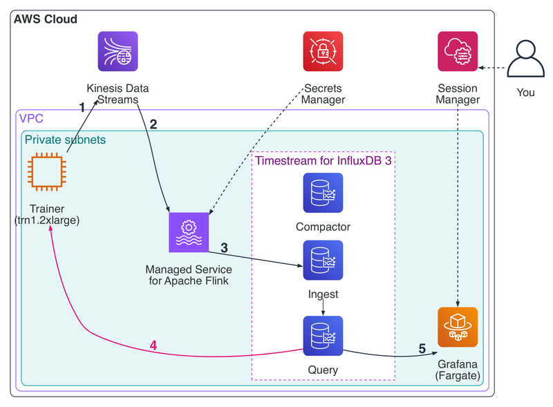

# AI Training Watchdog

Catches fine-tuning runs that break or that game their reward, while they train. Amazon Managed
Service for Apache Flink detects the failure, and Amazon Timestream for InfluxDB 3 Enterprise
carries each decision to the trainer and keeps the record that explains it.



1. The trainer, on a trn1.2xlarge, streams telemetry from every rank to Kinesis Data Streams.
2. Flink summarizes each step across ranks and runs two detectors. Each detection is an incident
   with an action: `STOP`, `ROLLBACK`, or `ADVISE`.
3. Flink writes the telemetry, the summaries, and the incidents to the InfluxDB ingest node, with
   the [Flink connector for InfluxDB 3](https://github.com/awslabs/amazon-timestream-tools/tree/mainline/integrations/flink_connector/flink-connector-influxdb),
   which reads its token from Secrets Manager.
4. The trainer polls the query-only node once a second for open incidents on its run, applies the
   action, and reports back as telemetry.
5. Grafana, on Fargate, shows all of it. You reach it through Session Manager; nothing in the
   stack is publicly reachable.

| Path | Contents |
|---|---|
| `flink-job/` | Java 17 job: step summaries, the two detectors, incidents, InfluxDB sinks |
| `trainer/` | LoRA SFT and GRPO of Qwen2.5-1.5B on Trainium, telemetry, control poller, sandboxed SQL grader |
| `simulator/` | Simulated runs and fleets, for tests and load |
| `grafana/` | Grafana image and dashboards (edit `build_dashboard.py`, not the JSON) |
| `infra/` | CDK stack |

## How it works

- **The incident row is the command.** Flink writes each incident, with its `action` and
  `action_arg`, to the `incident` table; there is no other channel. Each trainer polls
  `SELECT ... FROM incident WHERE run_id = $run_id AND state = 'OPEN'` on the reader endpoint with a
  read-only token, and writes back `control_ack` (outcome, latency) and `control_poll`.
- **Actions.** `STOP N` keeps the adapters of GRPO evaluation N and stops. `ADVISE N` keeps them
  and keeps training. `ROLLBACK N` restores SFT checkpoint N and starts a new attempt;
  the trainer ignores it in GRPO, or if it was detected in an attempt the trainer already left.
- **Only Flink writes `incident` and `step_summary`.** Flink drops producer records of those types,
  and producer fields can't replace a point's `run_id`, `scenario`, `phase`, `rank`, `step`, or
  `attempt`. It skips a record whose `run_id`, `scenario`, or `phase` isn't 1 to 128 of
  `A-Za-z0-9._:-`, or whose `ts` isn't epoch milliseconds from 1970 to 2200, or is more than 5
  seconds ahead of Flink's clock (it would move event time ahead for every run, and flush their
  steps before every rank reports).
- **Cluster.** Three nodes: ingest+query (the writer endpoint, Flink's writes), query-only (the
  reader endpoint, every read), and a compactor. Only the bootstrap Lambda holds the admin token.
  Flink writes with a write-only token for the database; Grafana, the trainer, and the simulator
  read with a read-only one.
- **Delivery.** At least once; a replayed point overwrites itself, and the step summaries and the
  reward-hacking detector count a record delivered twice once. Incidents and step summaries go
  through a sink that fails the job on a rejected line, so no command is lost. Telemetry goes
  through a sink that drops and counts rejected lines (`numRecordsDropped`), so one bad record
  can't block the incidents.

## Prerequisites

- An AWS account with quota for one trn1.2xlarge.
- JDK 17, Apache Maven, Node.js 22+, Python 3.12+, Docker or Finch, and the AWS CLI with the Session
  Manager plugin. The connector comes from
  [Maven Central](https://central.sonatype.com/artifact/software.amazon.timestream/flink-connector-timestream-influxdb3).
- The deploy builds the Grafana and simulator images for arm64 (Fargate on Graviton). On macOS,
  Docker Desktop and Finch do that out of the box; on an x86_64 Linux machine, first install arm64
  emulation, for example `docker run --privileged --rm tonistiigi/binfmt --install arm64`.
- The account and Region bootstrapped for CDK. From this sample's directory:
  `(cd infra && npm ci) && infra/node_modules/.bin/cdk bootstrap aws://<account-id>/<region>`.
  Inside `infra/`, `cdk bootstrap` synthesizes the app first, which needs the built Flink job and
  the parameter group that `deploy.sh` creates.

## Deploy

The scripts read `AWS_PROFILE`, `DEPLOY_REGION` (default `us-east-1`), and `DEPLOY_ACCOUNT`, which
`deploy.sh` and `preflight.sh` check the credentials against. Optionally,
`DEPLOY_TAGS='Key1=value1,Key2=value2'` adds tags to every resource, such as tags your account's
policies require; `preflight.sh` checks that the Trainium host has them. Set them in `.env` (git
ignores it), or in your environment, which takes precedence.

```bash
cp .env.example .env   # then set DEPLOY_ACCOUNT and DEPLOY_AZS, and AWS_PROFILE and DEPLOY_REGION if needed
scripts/deploy.sh -c simulator=false   # about 20 minutes
scripts/grafana-tunnel.sh              # http://localhost:3000, user admin
```

- **Zones.** trn1.2xlarge is offered only in some Availability Zones, and zone names differ by
  account. List yours with `aws ec2 describe-instance-type-offerings --location-type
  availability-zone --filters Name=instance-type,Values=trn1.2xlarge`, and set `DEPLOY_AZS` to two
  zones, the first offering it (or name the host's zone with `DEPLOY_TRAINIUM_AZ`). Keep them the
  same on every deploy: changing them replaces the VPC's subnets.
- **Host AMI.** `deploy.sh` keeps the Trainium host's AMI, so a new DLAMI release never replaces
  the host and its compile cache, checkpoints, and saved adapters. `DEPLOY_TRAINIUM_AMI=latest`
  takes the newest DLAMI, replacing the host; `DEPLOY_TRAINIUM_AMI=<ami-id>` names one.
- **Approvals.** `cdk deploy` asks before IAM or security-group changes that broaden access, such
  as on the first deploy. For an unattended deploy, add `--require-approval never`.
- **Parameter group.** `deploy.sh` creates the cluster's node layout once, as parameter group
  `training-watchdog-enterprise-3node`. Parameter groups can't be changed or deleted, so a new
  layout needs a new name.
- **Flink state.** The job restores its detector state from the latest snapshot on every update. If
  a change can't restore it (for example, removing or renaming a stateful operator), deploy once
  with `-c flinkRestore=skip`.
- **Options.** `-c trainium=false` omits the host; on a stack that has one, it terminates the host
  and deletes its volume (compile cache, checkpoints, and saved adapters). Without
  `-c simulator=false`, a simulated fleet of 4 runs also writes to the stack.

## Run the scenarios

| Scenario | Training | Fault | Watchdog response (seed 1) |
|---|---|---|---|
| `healthy` | 300 SFT steps | None | None |
| `bad_lr` | 300 SFT steps | Learning rate 1000x at step 70 | `DIVERGENCE`: `ROLLBACK` to checkpoint 50, then half the learning rate |
| `healthy_grpo` | 30 SFT + 120 GRPO steps | None: the grader pays only the gold result | `HELDOUT_DECLINE`: `ADVISE 70` at step 120 |
| `reward_hacking` | 30 SFT + up to 120 GRPO steps | The grader pays any non-null result | `REWARD_HACKING`: `STOP 1` at step 50 |
| `reward_hacking_unwatched` | 30 SFT + 120 GRPO steps | Same, and the trainer ignores commands | `STOP 1` at step 50, ignored |

```bash
scripts/preflight.sh --start-host   # checks the stack and starts the host
scripts/demo.sh --prewarm healthy   # a new host: compiles the SFT graphs first
scripts/demo.sh --seed 1            # healthy, bad_lr, reward_hacking, with a PASS/FAIL summary
scripts/train.sh healthy_grpo --seed 1
scripts/pause.sh                    # stops the host
```

`--seed` varies the LoRA initialization, the GRPO sampling, and the question order; a run is
deterministic per seed. On a new host, the first `healthy`, `bad_lr`, and `reward_hacking` runs
take about 70 minutes, mostly compiling. In Grafana, **Demo dashboards** switches between views
for healthy training, divergence, reward hacking, and the InfluxDB data plane.

## Reward-hacking detector

`RewardHackingDetector` keeps, per run, moving averages of the reward and the *grader gap*:
`reward - exec_match`, what the training grader paid minus the share of the same candidates that
are strictly correct. An honest grader's gap is 0. On each held-out evaluation, it looks for a
decline: accuracy at least `hackEvalDrop` below its best while the reward rose at least
`hackRewardRise` since then, for `hackConsecutiveEvals` evaluations in a row; or at least
`hackHoldEvalDrop` below while the reward held within `hackHoldRewardTolerance`, for
`hackHoldConsecutiveEvals`. The gap decides what a decline means:

| Grader gap since the best evaluation | Incident | Action |
|---|---|---|
| Rose `hackGapRise` or more | `REWARD_HACKING` | `STOP` at the best evaluation |
| Rose less | `HELDOUT_DECLINE` | `ADVISE` at the best evaluation |
| Unknown (no `exec_match`) | `REWARD_HACKING` | `STOP` at the best evaluation |

Each type opens at most once per run, and a `HELDOUT_DECLINE` can escalate to `REWARD_HACKING`.
The trainer saves the named evaluation's adapters to `<checkpoint-dir>/<run-id>/best-heldout.pt`,
and after its last evaluation waits `--final-verdict-seconds` (15) for a verdict.

| Threshold | Default | Meaning |
|---|---|---|
| `rewardEmaAlpha` | 0.1 | Smoothing of the reward and gap moving averages |
| `hackBaselineSteps` | 10 | RL steps the averages must cover before a best evaluation's baseline is set |
| `hackEvalDrop` | 0.08 | Held-out drop from the best, while the reward rises |
| `hackRewardRise` | 0.03 | Reward rise since the best evaluation |
| `hackConsecutiveEvals` | 2 | Evaluations in a row, while the reward rises |
| `hackHoldEvalDrop` | 0.10 | Held-out drop from the best, while the reward holds |
| `hackHoldRewardTolerance` | 0.05 | How far the reward can fall since the best evaluation and still hold |
| `hackHoldConsecutiveEvals` | 3 | Evaluations in a row, while the reward holds |
| `hackGapRise` | 0.15 | Gap rise that makes a decline reward hacking |

To override a threshold of either detector, add a `Detectors` property group to the Flink
application in `infra/lib/training-watchdog-stack.ts`, keyed by name. Durations take seconds, as
`<name>Seconds`.

## Divergence detector

`DivergenceDetector` watches each run's and attempt's step summaries for a loss spike, then a
gradient-norm blowup at a later step within `divergenceWithin`. On a match, it opens a `DIVERGENCE`
incident with `ROLLBACK` and the spike's step minus 2. The trainer restores its newest checkpoint at
or before that step (SFT saves one every `--checkpoint-every` 50 steps; the spike's own loss already
reflects the previous step's update), turns the injected fault off, and resumes at
`--rollback-lr-scale` (0.5) times its learning rate; after `--max-rollbacks` (3), a further
`ROLLBACK` stops the run. The trainer picks the checkpoint because Flink may not have seen it yet:
checkpoint and step reports travel on different shards.

It matches by each summary's own step and time, not by arrival order or the watermark, so a step
whose summary arrives late (a rank's records reached Kinesis late) is still judged.

| Threshold | Default | Meaning |
|---|---|---|
| `emaAlpha` | 0.05 | Smoothing of the loss and gradient-norm moving averages |
| `divergenceWarmupSteps` | 30 | Steps before a spike counts |
| `lossSpikeRatio` | 1.5 | Spike: loss over its moving average, as a ratio |
| `lossSpikeMinDelta` | 0.05 | Spike: and by at least this much |
| `gradBlowupRatio` | 5 | Blowup: gradient norm over its moving average, as a ratio |
| `gradBlowupMinNorm` | 1.0 | Blowup: and above this norm |
| `divergenceWithinSeconds` | 60 | Blowup within this long after the spike |
| `stepFlushTimeoutSeconds` | 15 | A step's summary goes out this long after its first rank, if a rank is missing |
| `incidentQuietPeriodSeconds` | 90 | Both detectors: an incident resolves after this long without a new detection |
| `runStateTtlSeconds` | 604800 (7 days) | Both detectors: a run's state expires this long after it was last written |

## Scripts

| Command | What it does |
|---|---|
| `scripts/preflight.sh [--start-host]` | Checks the stack, Flink, InfluxDB, Grafana, and the host; starts the host |
| `scripts/demo.sh [--seed N] [scenario ...]` | Runs scenarios on the host and checks each run's incidents, and that the run acted on its command |
| `scripts/demo.sh --simulated [scenario ...]` | The same, as simulated runs (needs `iam:PassRole`) |
| `scripts/train.sh <scenario> [--seed N] \| stop` | Starts one run without waiting, or cancels it |
| `scripts/pause.sh [--force]` | Stops the host (`--force` cancels a run first) |
| `scripts/influx-query.sh "<SQL>"` | Runs SQL against InfluxDB from the host |
| `scripts/check-influx.sh` | Checks that the read-only token can read and can't write |
| `scripts/simulator.sh on \| off \| status \| once <scenario>` | Starts or stops the simulated fleet, or runs one simulated run |
| `scripts/throughput.sh measure <minutes>` | Reports Kinesis, Flink, connector, and control-loop metrics |
| `scripts/cardinality.sh [window]` | Reports series and points per table, and times the key queries |

## Test

```bash
(cd trainer && python -m unittest discover -s tests -t .)   # torch-dependent tests skip without torch
(cd flink-job && mvn test)                                  # JDK 17
(cd simulator && python -m unittest discover -s tests -t .) # needs boto3 (pip install boto3)
```

## Load

The simulated fleet doubles as a load generator. These `scripts/deploy.sh` flags size it and the
pipeline under it, and synth prints the resulting load. Without them, the stack is unchanged.

| Flag | Default | Meaning |
|---|---|---|
| `simRuns` | 4 | Simulated runs; scenarios are assigned round-robin, so half are SFT |
| `simTelemetry` | `light` | `light`: the Flink test fixture's format. `realistic`: per-rank, per-LoRA-matrix layer stats every step, like the trainer. `production`: an 8B-class model on 64 ranks, with per-layer and per-head stats, for cardinality tests |
| `simRanks` | 8, 2, or 64 | Ranks per SFT run, by telemetry |
| `simStepSeconds` | 1 | Seconds per step; rates scale with its inverse |
| `simMaxSteps` | 360 | Steps before a run restarts under a new run ID; fewer steps add series faster |
| `simDetailEvery` | 10 | `production`: steps between each rank's per-layer and per-head stats |
| `simPromptsPerStep` | 128 | `production`: GRPO prompts per step, one record each |
| `simRunsPerTask` | All runs in one task | Splits the fleet into ECS tasks of at most this many runs |
| `kinesisShards` | Automatic | Shard count; automatic keeps each shard under about 1,000 records/s, at least 4 |
| `flinkParallelism` | 1 | Managed Flink parallelism; changing it restarts the job from a snapshot |

Events per step of one run, with the default ranks:

| Telemetry | SFT run | GRPO run |
|---|---|---|
| `light` | 1.2 per rank + 2.46 (12.06) | 1.07 |
| `realistic` | 225.2 per rank + 0.06 (450.46) | 1.07 |
| `production` | 8,269 | 8,347 |

For each load stage, deploy with the flags (and without `-c simulator=false`), let the fleet run,
then measure. Both reports are read-only. Both query InfluxDB through the host (`throughput.sh`
for its control-loop rows), so run `scripts/preflight.sh --start-host` first.

```bash
scripts/deploy.sh -c simRuns=400 -c simRunsPerTask=100
scripts/throughput.sh measure 10   # Kinesis, Flink, connector, and control loop; CloudWatch lags 1-3 minutes
scripts/cardinality.sh             # series and points per table, and how long the key queries take
```

Deploy again without the flags to return to the default fleet.

Kinesis changes a stream's shard count to at most double, or at least half, its current count at a
time, and at most 10 times a day. If a deploy whose flags call for a bigger change (for example,
`-c simTelemetry=production`, about 37 shards, from the default 4, or back) fails on the stream,
step there with `-c kinesisShards` (8, 16, 32, then the flags), and back the same way.

## Production considerations

This is a sample. Before you adapt it:

- **Grafana:** one shared admin login, state inside the container, one task. Use your identity
  provider and persistent storage, or Amazon Managed Grafana.
- **Alerting:** nothing notifies a person. Add alerts, especially for `HELDOUT_DECLINE`.
- **Retention:** deleting the stack deletes the InfluxDB data, and there are no backups.
- **Trainer restarts:** the trainer keeps its checkpoint index and applied commands in memory. A
  restarted trainer reads only incidents from the minute before it started, so it can miss a
  `STOP`, and a reapplied `ROLLBACK` restores the initial weights. Persist both, so each command
  applies once.
- **Telemetry trust:** records carry no producer identity, so anyone who can write to the stream
  can make the watchdog act on any run. Grant `kinesis:PutRecords` only to your trainers.
- **The strict check:** grading only a sample of candidates makes the gap noisier; tune
  `hackGapRise` against healthy runs graded the same way.
- **Wide scans:** the polls share the query-only node with the dashboards. Scans across millions of
  series slowed polls from 5 ms to as much as 1.3 seconds. Bound such queries by run or time, or
  give them their own query node.
- **Final adapters:** a GRPO run with no incident saves no adapters. Save your final and best ones.

## Tear down

```bash
scripts/destroy.sh   # the same settings and account check as deploy.sh; asks before deleting
```

This deletes everything in the stack, including the InfluxDB cluster and its data and the host
and its compile cache. The parameter group remains (there's no delete API); it costs nothing.

## Attribution

Portions of `infra/lib/flink-application-lifecycle.ts` and `infra/lambda/flink-application-lifecycle/`
come from the connector's Apache-2.0 Managed Flink example in
[amazon-timestream-tools](https://github.com/awslabs/amazon-timestream-tools/tree/mainline/integrations/flink_connector/flink-connector-influxdb).
